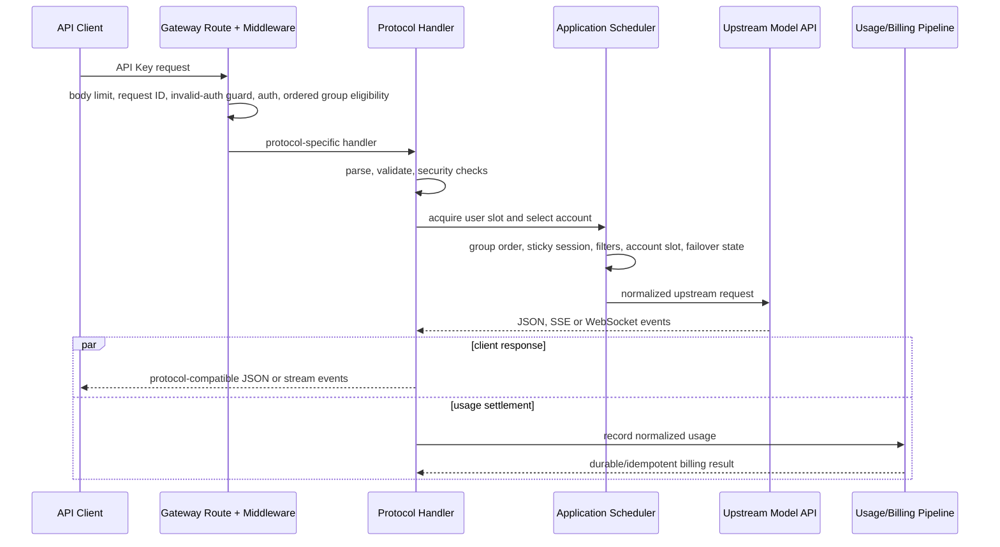
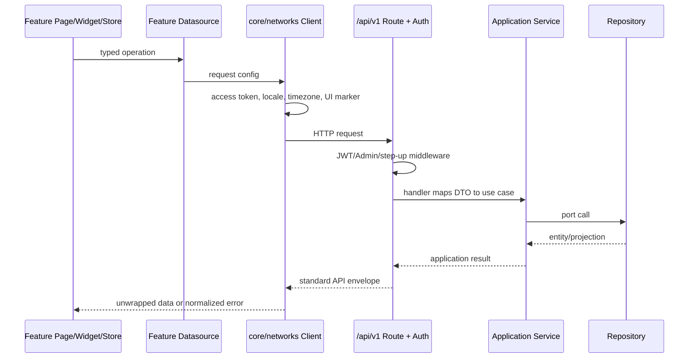

# Sub2API 关键请求链路

账号列表批量同步上游模型由 `admin-accounts` 的同步 composable 顺序分批调用管理端账号路由，经 `account_models_batch.go` 进入 `AccountTestService.BatchSyncUpstreamModels`。该用例复用平台模型查询，通过 repository 的行锁/JSONB 合并新增映射，同时写 scheduler outbox 并刷新缓存；失败账号保留原配置。规则与验证见 [批量同步说明](ACCOUNT_UPSTREAM_MODELS_SYNC.md)。

本文给出高频链路的阅读顺序和不变量。它刻意省略平台内部的全部分支；调试具体问题时，应从命中的路由和 handler 继续追踪。

## API Key 模型请求

典型入口包括 TypeSafe 原生非流式 `/v1/systemone`、`/v1/messages`、`/v1/responses`、`/v1/decisions`、`/v1/chat/completions`、`/v1beta/...` 以及无 `/v1` 的兼容别名。所有绑定在 `backend/internal/transport/http/server/routes/gateway.go`。

OpenAI Decisions 使用独立的 JSON 转发链路：`POST /v1/decisions`（并提供 `/decisions` 别名）只从 OpenAI API-key 账号中调度，原样保留 `input`、`questions` 和 typed `answers`。上游地址固定按账号 `base_url` 拼接 `/v1/decisions`；上游返回的 `usage.input_tokens`（若存在）进入统一 OpenAI 用量结算，Responses 转换器不会改写该请求。



流式事件可能在最终用量结算前已经发送给客户端；这也是结算必须可恢复、幂等且不能依赖客户端连接继续存活的原因。

OpenAI 文本 Responses 流式请求在本地校验和安全检查通过后、并发准入和选号之前启动下游 SSE 注释心跳，原生与透传 Forward 的令牌读取/刷新也复用同一个心跳器，避免等待上游 HTTP 请求发出前，下游 Sub2API/New API 已因收不到响应头超时。首拍仍遵循管理员的 `stream_keepalive_interval_seconds`（默认 10 秒，0 为关闭）；快速错误保留原 HTTP 状态，首拍之后的错误使用 `response.failed` 终止事件。心跳不算语义输出，不阻止安全换号；非流式和图片请求保留各自的响应方式。下游先断开时，本站通常只观察到客户端取消，后台启用 `IgnoreContextCanceled` 时会过滤这类记录，不能据此排除下游等待超时。

上游用量中的 reasoning token 作为输出 token 的子集记录在 `usage_logs.reasoning_tokens`：OpenAI Responses/Chat Completions（HTTP、SSE 和 WebSocket）读取对应的 `*_tokens_details.reasoning_tokens`，Gemini 兼容链路读取 `usageMetadata.thoughtsTokenCount`。未报告计数及历史数据保持 NULL，明确返回 0 则保存 0。该字段不加入计费总量，只由管理员 DTO 返回，并在管理端请求明细、详情和导出中独立展示；用户 DTO 和用户 audience 不展示。

模型字段在鉴权之后、分组白名单和合成路由改写之前必须通过 `GatewayModelValidation`。JSON 顶层 `model`、`session` 和 `session.model` 的重复键（含大小写与转义别名），以及 multipart 重复 `model`/`session` 字段返回协议兼容的 400；该检查不依赖模型白名单开关。Responses WebSocket 在每个原始客户端帧读入时执行同一检查，歧义帧以 1008 关闭，避免调度、上游解析和计费分别采用首值或末值。工具 schema 和消息内容中的模型字段不属于这一边界。

用户端 API Key 创建与分组修改统一校验每个 `group_id`/`group_bindings` 候选的 active 状态及用户授权；原绑定列表完全不变时，改名或编辑自有 Key 的消费上限仍允许保存，已经停用的旧候选由运行时路由过滤。`quota` 是 Key 的自设消费上限，余额与订阅扣费不因调整它而豁免。

API Key 的 IP 白名单/黑名单随鉴权快照预编译；较大的规则集使用 [IP 前缀布隆过滤器](../backend/internal/shared/ip/README.md) 快速排除不匹配的网络，可能命中时仍执行精确 CIDR 比较。通用与 Gemini 原生入口共用该规则，无额外 DB/Redis 查询，黑名单优先与拒绝响应保持原有语义。

API Key 入口可用 `api_key_auth_cache.bloom.enabled`（环境变量 `API_KEY_AUTH_CACHE_BLOOM_ENABLED`，默认 false）启用共享布隆成员预筛。本地 hot/L1 命中仍不访问 Redis；其余请求先通过一次 Redis Lua 查询，确定不存在即返回原有 401，无 L2 鉴权查询或数据库回源，也不为随机凭据写负缓存。可能存在继续原有鉴权，布隆误判不会授权请求；未完成预热、Redis 出错或位图丢失时回退原查找，原有回源并发上限和 IP 风控继续生效。

启用前必须升级所有 API Key 写入节点，并在所有写入节点启用；直接 SQL 导入/修改凭据或回退旧二进制前，先在所有节点关闭预筛。创建路径在 PostgreSQL 共享事务锁内先向共享位图登记，再提交数据库；预热在排他锁内分页读取全部未删除 Key（含停用/过期），与 Redis 代次校验一起避免重启、并发创建和漏同步导致新 Key 被拒。Redis 登记失败时该次创建失败，不提交未登记凭据。位图追加保留已删除 Key 的位，因此删除仍由原精确鉴权与失效路径拒绝。后台每 30 秒检查/恢复，单节点只有一个可取消 worker，重建最长两分钟；随机 Key 不触发逐请求扫描。此优化减少 PostgreSQL 和 L2 缓存负载，未缓存的随机 Key 仍需一次 Redis 查询，不能替代入口流量防护。


Codex CLI 语音通过 Live 创建与 Sideband 控制链路接入，`gpt-live-1-codex` 使用 CLI 的可选证明契约；语音按分钟结算，任务模型另按 token 计费。倍率与配额策略在创建时冻结，Redis 保留未结算会话，由固定批量恢复器完成幂等扣费和用量写入。客户端 Sideband 地址与升级/回退边界见 [Codex CLI 语音](CODEX_VOICE.md)。

Responses 走图片编辑桥接时，用户提交的图片与遮罩 URL 在共享解析阶段携带独立公开地址策略。HTTP port 的 repository 实现对全部 DNS 结果与重定向逐跳校验，再连接固定 IP；账号代理/IPv6 出口仍随请求传递，管理员私网上游例外不能放宽用户输入。接口、计费和本地图片输入边界见 [媒体工坊安全说明](CUSTOM_MODELS_AND_MEDIA.md)。

普通 OpenAI OAuth 账号在 `extra.excel_bps_enabled=true` 且不是独立 compact 路径时将 Responses 请求转入账号级 Excel/Basispoints 桥接；桥接不支持的原生托管工具显式报错，不静默回退。账号管理页的 `excel_bps=enabled|disabled` 在 PostgreSQL JSONB 谓词中先于分页计算，同时用于批量编辑目标解析、导出和上游计费快照；批量 BPS 开关在写入前校验所有账号资格，SQL 写入时复查并保持整批原子性；DeepSeek 专用兼容调整分别落在 Responses 出站请求与 Chat Completions 出站/回退链路。配置、能力边界和验证入口见 [Excel BPS 与 DeepSeek 兼容](BPS_DEEPSEEK_COMPAT.md)。

OpenAI OAuth Responses、自动透传和原生 WebSocket 握手收到上游 `401` 且错误码为 `token_expired`，或 ChatGPT Team 工作区返回无结构化错误码的通用 Unauthorized 时，网关先删除该账号的 token 缓存，在分布式刷新锁下强制执行一次 refresh token 流程，即使数据库中的 `expires_at` 仍在未来；刷新成功后仅重放当前请求一次并继续使用同一账号。刷新失败、refresh token 缺失、`token_revoked`/`token_invalidated`、明确的禁用/撤销错误码或再次收到 401 继续走原有账号冷却、永久错误和 failover 策略。OpenAI OAuth refresh 响应缺少 `id_token` 时，系统从新的 access token 重新提取 ChatGPT/Team workspace、用户、套餐和 POID 字段，避免沿用旧 workspace 路由身份。

OpenAI OAuth 历史重放会移除 `type=reasoning` 条目中的非空 `content` 数组，因为 ChatGPT Codex 输入契约的该字段最大长度为 0；保留整个条目、`summary` 与 `encrypted_content`，不截断顶层 `input` 历史，也不改写普通消息或工具内容。普通/透传 HTTP、compact 与原生 WebSocket 每轮使用同一约束；API Key 账号不应用该 OAuth 专用转换。原始 JSON 路径保留其它字段的数值精度与内容字节。

## OAuth2 对外授权

第三方应用从 `/oauth/authorize` 发起 Authorization Code + PKCE S256 请求。前端要求用户先登录，再通过 `/api/v1/oauth2/authorize` 读取服务端校验后的客户端与 scope 预览；用户允许后，后端将 authorization code 摘要及用户、客户端、精确回调、scope、PKCE challenge 和 TokenVersion 保存到 Redis。`/oauth/token` 原子消费 code，复查客户端、回调、PKCE 和用户状态后签发不透明 access token。`/oauth/userinfo` 每次调用都重查全局开关、客户端启用状态、当前 scope 和用户 TokenVersion，因此管理员收回授权后无需等待 token TTL。完整协议和管理端入口见 [OAuth2 对外授权服务](OAUTH2_PROVIDER.md)。

OAuth2 token 的认证域与站内 JWT、Admin API Key、模型网关 API Key 相互独立，不进入网关调度或计费链路。

### 账号级质量监控与降智分组切换

管理员在独立的 `/admin/account-quality` 保存质量策略并启用质量巡检，可指定 `source_group_id` 作为检测源；后台只筛选状态启用且已启用调度（`schedulable=true`）的 OpenAI/Gemini OAuth 账号，API Key、service account 和关闭调度的账号不会进入检测队列；后台复用账号测试的真实上游传输路径，按
`interval_minutes` 对账号执行两个可独立开关的阶段：`stage1_enabled` 开启糖果形状/口味保证题（默认 `stage1_answer=21`），`stage2_enabled` 开启 SVG 鹈鹕骑自行车画图题并进行代码匹配和预览渲染。管理员可编辑 `stage1_prompt`、`stage1_answer` 和 `stage2_prompt`。只运行启用的阶段；全开时先文字题再画图。答案必须匹配配置答案且代码匹配规则通过才算通过。答错、代码匹配未通过或第一阶段 reasoning token 低于阈值显示为 `degraded`；`failure_threshold` 决定连续失败几轮后自动切组，恢复遵循 `recovery_threshold`。请求或分类错误不递增失败计数。选择检测源分组后探测范围为源分组和配置的降智分组；由旧配置迁出的账号也会继续探测，以支持恢复。未配置检测源时扫描全部符合上述条件的账号。账号健康巡检在 `/admin/account-inspection` 使用独立设置、状态和调度器，两个入口互不触发。

配置 `degraded_group_id` 后，首次进入降智状态会先把原 `account_groups` 列表写入账号
`extra.account_quality_original_group_ids`，再通过现有 `BindGroups` 事务绑定目标分组并写 scheduler
outbox。目标分组必须存在、启用且与账号平台一致；切换失败不会静默修改原分组。连续通过达到
`recovery_threshold` 时，仅当账号仍停留在记录的降智分组，系统才恢复原分组；降智分组中没有历史
迁移标记的账号仅在当前绑定恰好等于该降智分组时回到配置的源分组。管理员在此期间手动改到其他
分组或增加绑定时保留手动结果。未配置目标分组时质量状态仍可观测，但不改变调度资格。

质量监控默认并发 4 个探测，管理员可在质量策略中设置 1–200 的 `max_concurrent`（上限 200）。若检测间隔短于上一轮耗时，新的定时/手动轮次进入单槽待开始队列并合并重复请求，当前轮次不取消；上一轮完成后立即启动排队轮次。第一阶段使用 `timeout_seconds`（默认 120 秒，可由管理员设置为 30–300 秒）；第二阶段的该值只限制“尚未收到任何流式内容”的等待时间。OpenAI 画图探测使用 Responses 流式请求，收到首个内容/图片事件后不再触发这项短超时，继续等待上游完成；整个质量运行仍受外层运行预算约束。传输、鉴权或无输出超时错误显示为本次 `error`，但不递增质量失败计数，也不触发降智分组切换。第一阶段从上游实际 usage 提取 reasoning token：OpenAI Responses 的 `response.usage.output_tokens_details.reasoning_tokens`、Chat Completions 的 `usage.completion_tokens_details.reasoning_tokens`，Gemini 的 `usageMetadata.thoughtsTokenCount`。缺失用量显示未知；启用阈值时该次结果为待确认，不按 0 判降智。`min_reasoning_tokens` 默认 0（仅展示），管理员可设置 0–1000000；严格小于阈值判为降智，等于阈值通过。摘要提供 0–49、50–99、100–249、250–499、500–999、1000+ 六个区间、均值、已测和未知数量；汇总在分页和截断前完成。状态、连续计数和最近 24 次阶段摘要存入 `accounts.extra`，探测不写入用量日志；公开页仅展示下文列出的最终回答，不展示推理正文。

OpenAI OAuth 质量探测会读取上游响应头 `X-Codex-Turn-State`。只有质量阶段判定为 `passed` 的值才写入管理员质量运行结果；降智、待确认和请求错误产生的值不会进入可同步集合，公开质量看板也不返回这些值。质量策略的 `inject_turn_state` 是独立对照开关：开启后，每个 OpenAI 探测阶段从“Codex OAuth A/B/C 模拟”的当前账号可用池随机选择一个 state 注入，同时在管理员结果表分别显示本次注入值和响应采集值；Gemini 探测不注入该头。

画图阶段的质量判定改为后端 Go 代码匹配：`modules/qualityrender` 按提供的 `model_a_fingerprint.py` 规则，对完整 HTML/SVG 计算 9 项加权特征（总分 100，默认阈值 55），记录命中特征、缺失特征和规则版本。分数表示代码结构相似度，不是概率；管理员可设置阈值，也可选择命中 Model A 或未命中 Model A 为正常。旧 `min_confidence` 字段继续返回以兼容已有配置，但不再参与代码匹配判定；已有非空 `ACCOUNT_QUALITY_RENDERER_URL` 仍只用于生成预览。

预览渲染改由前端浏览器完成：后端仅在 `probe_details.stage2.preview_html` 保存经过 CSP/外链过滤且最多 256 KiB 的 HTML，公开接口返回该字段；前端使用 `iframe srcdoc` 与 `sandbox="allow-scripts"` 加载自包含动画，历史 PNG/WebP 记录仍可通过原图片接口查看。主 Docker 镜像不再安装 Python、Chromium 或 Playwright，代码匹配仍在后端 Go 中执行。预览 HTML 不允许外部网络、框架、对象、表单或事件属性，代码匹配先于预览生成，浏览器预览失败不会丢失匹配分数和对话详情。公开接口不返回账号凭据或原始请求；没有回答、对话/响应 ID、代码匹配或预览的空失败记录不会出现在公开时间线和详情卡片中。流式画图即使在结束前中断，只要已收到部分 SVG/HTML，仍会执行代码匹配并记录 `source_complete=false`；第二阶段状态显示“输出被中断，分析可能错误”，但账号总结果以第一阶段文字题为准（第一阶段通过则整体通过，第一阶段答错仍判降智）。仅启用第二阶段时，不完整输出判为待确认。

手动调用 `/api/v1/admin/account-quality/run` 会立即返回 `running` 状态；后台继续执行并持久化 `progress.total/completed/running/queued` 和各账号 `quality_phase`（排队、文字题、绘图生成、渲染分类、保存、完成或中断），管理页每 5 秒轮询展示总任务进度和账号级阶段进度。调度触发仍使用同一质量运行器并等待完整结果。开启 `quality_public_enabled` 后，匿名页 `/monitor/quality/public` 读取
`GET /api/v1/account-quality-share`，按 manxue.ai 风格展示 24 小时摘要、可点击状态时间线、检测对话/响应 ID、两阶段最终回答文本、reasoning token 和图片预览；回答只保留最多 16 KiB 并在前端按纯文本渲染，不返回账号 ID、凭据或原始请求。图片由
`GET /api/v1/account-quality-share/image/:id?format=png|webp` 提供，并限制 24 小时保留。历史记录如果没有对话详情会显示“上游未返回”，不会伪造 ID。

### 阅读顺序

1. `routes/gateway.go`：确认实际命中路径、middleware 顺序和平台分流。
2. `server/middleware/api_key_auth.go`：确认 API Key、用户、分组和订阅如何进入 context。
3. 协议 handler：Anthropic 从 `gateway_handler_messages.go`，OpenAI Responses 从 `openai_gateway_responses.go` 开始。
4. `application/service/gateway_scheduling.go` 或 `openai_account_scheduler.go`：确认候选账号和会话粘性。
5. 对应 `gateway*_forward*` / `openai*_forward*`：确认上游请求与响应转换。
6. `gateway_usage_billing.go` 或 `openai_gateway_usage.go`：确认用量解析和计费提交。

### 蒸馏分组轻量链路

管理员将分组的 `is_distillation_group` 设为 `true` 后，对 Anthropic OAuth/SetupToken 和
OpenAI OAuth 账号启用该链路。网关会删除请求体中的 `prompt_cache_key`、`prompt_cache_retention`、
`cache_control` 及代理生成的缓存断点；每个分组/账号的请求计数按 10000 个逻辑请求划分
session ID 窗口，同一窗口内的重试状态复用同一个合成 session ID。蒸馏链路不读取或保存
上游 session 缓存对象。

蒸馏分组只执行一次上游请求：跳过传输重试、指数退避、thinking/budget/tool 错误修正、账号
failover 和 fallback 分组；失败时立即返回协议兼容错误。鉴权、计费准入、槽位释放、取消处理、
用量幂等写入和 HTTP/SSE/WS 终止事件仍然执行。普通分组继续使用既有缓存、重试和 failover 规则。

### Claude Code -> OpenAI 会话信号

OpenAI 兼容入口的会话键按以下顺序解析：显式 `session_id`/
`conversation_id` 及 `X-Claude-Code-Session-Id`，请求体
`prompt_cache_key`，再到 Claude Code 的 `metadata.user_id` /
`metadata.session_id` 身份信号。Claude Code 元数据优先于内容派生 fallback；因此同一会话在
系统提示、工具或消息尾部变化时仍保持账号粘性。对 OpenAI OAuth 的原生
`/v1/responses` 请求，如果客户端只提供 Claude 元数据，网关会生成一个稳定、独立
命名空间的 `prompt_cache_key`，不向任意 API-key 兼容网关强行注入未知字段。若某次
请求因上游容量/传输等 request-scoped 错误临时切换账号，当前请求可以由备用账号完成，
但后续轮次仍保留原粘性账号绑定；只有账号级不可用状态才清理该绑定。

高并发时，健康的粘性账号先使用其有限等待队列；只有队列已满才允许请求溢出到
负载均衡层，避免短暂的槽位竞争造成缓存冷启动和非预期切号。OpenAI OAuth 候选在
有界 Top-K 内遇到相同负载时使用请求级随机平局，避免固定低编号热集；批量负载快照
若将所有账号判为满载会先执行一次无缓存刷新，再创建兜底等待计划。

管理端 `/admin/ops/concurrency-snapshot` 同时返回 OpenAI 显式 session ID 的当前分钟
首次观测去重增长量（同一 session ID 在 1 小时内不重复计数）：平台、分组和账号行提供 `session_id_growth_per_minute`，响应级
`session_id_growth` 提供筛选范围内总增速和最大账号增速。该指标只保存在进程内短期内存，
按 UTC 分钟轮换，不进入用量聚合、账单或持久化表；内容派生会话不计入该指标。

系统设置的“OpenAI Session ID 每分钟限速”开关对应
`openai_session_id_rate_limit_enabled`，启用后按
`openai_session_id_rate_limit_per_minute` 对每个 OpenAI OAuth 账号的新增显式 Session ID 做
Redis 原子限速；OpenAI API Key 账号不经过该限速；0 表示不限制。达到上限的 OAuth 账号
从本次候选中排除，已有 Session ID 不重复消耗额度。

“OpenAI OAuth 每账号限速”由全局设置 `openai_oauth_gateway_rate_limit_enabled` 显式开启；关闭时请求路径
不访问对应 Redis key。开启后，所有 OpenAI OAuth 账号使用同一套 RPM/burst 配置，但每个账号拥有独立
Redis 令牌桶；同一账号的桶由所有应用实例共享，不按模型或应用实例继续拆分。
共享母账号 OAuth 凭据的影子账号使用母账号桶，不能通过影子记录获得额外额度。
`openai_oauth_gateway_rate_limit_rpm` 是持续补充速率，
`openai_oauth_gateway_rate_limit_burst` 是可立即消耗的突发容量。HTTP 请求的账号重试/切换按
`client_request_id` 在同一账号桶内去重；切换到另一个账号会消耗新账号自己的额度。Responses 的所有上游子路径（含 `compact`、`input_tokens`）、独立 Alpha Search 和 Live 建连均使用所选账号的桶，
WS 每个 `response.create` turn 单独计数；OpenAI API Key、模型列表、
额度查询和 OAuth 刷新不计入。启用状态下 Redis 不可用时失败关闭并返回 503，额度不足返回 429
和 `Retry-After`；额度不足时先排除当前账号并尝试其他候选账号，且不记为账号健康失败，全部候选耗尽后才向客户端返回 429。配置保存到共享设置表；当前节点立即使用新值，
其他节点最多在 5 秒设置缓存周期后使用相同配置。

`openai_request_integrity_observe_enabled` 只观察 OpenAI OAuth 请求在兼容转换前后的受保护语义字段；
差异日志仅包含账号 ID、传输类型和字段名，不保存请求正文，也不拒绝或重放请求。质量巡检的私有
artifact 同时保存本次模型、Codex 身份/传输、出口、并发和上述网关控制的非敏感运行快照；公开质量页
会删除该运行快照。

OpenAI Responses 请求在首个语义事件前使用
`gateway.openai_first_output_timeout_seconds`（默认 90 秒；
`high/xhigh/max` 可由 `gateway.openai_high_effort_first_output_timeout_seconds`
单独设置，默认 180 秒）。`response.created`、`response.in_progress`、
`codex.rate_limits`、`codex.response.metadata` 和 SSE 注释心跳不计作语义输出，
也不因配额或元数据帧而禁用首输出保护；超时会关闭当前上游连接。OpenAI LLM 的
`response.metadata` 中的 `metadata.openai_verification_recommendation` 只识别新版 Codex
定义的已知数组枚举并保留原事件，不改变重试或账号切换；workspace 元数据在 OAuth
principal 隔离前会移除本地路径和 remote 凭据。
HTTP Responses 请求在尚未提交语义字节、且错误允许重试时继续排除失败账号，直到成功或
可调度号池耗尽，不再受首输出一次切号和普通最大切号数的提前截断；透传路径每个已选择
账号最多四次 transport attempt，重选同账号不补充预算。非流式、图片及其他入口保持原预算。
HTTP SSE 等待响应头（包括换号后的等待）及响应体期间按
`gateway.stream_keepalive_interval` 发送注释心跳，换号和响应头/体阶段切换不重置保活时钟；
账号尝试的前导事件和普通响应头保持私有；若 keepalive 先提交 200，安全元数据改走 trailer，
因此仍可在同一下游连接内无感换号。该策略覆盖
原生 HTTP、HTTP 透传、WSv2 正式请求及其预热；显式设为
`0` 可关闭这项语义首输出保护；各 transport 仍有自己的响应/读超时约束，
但会重新暴露客户端长时间无真实输出后断流的风险。
WSv2 在首语义输出前耗尽内部重连预算时，会把读取/连接类失败转换为统一的
账号 failover 信号；不会落到通用 `Upstream request failed`，也不会重放已经提交的语义事件。

`gateway.openai_ws.http_bridge_enabled` 开启时，包含内嵌 `data:image/...` 图片的完整请求
在发送上游前直接选择 HTTP Responses，避免多图 Base64 内容触发上游 WS 消息大小限制。
这同时覆盖 HTTP 入站的账号预热路径，以及原生 WS 的 ctx_pool/passthrough 首包；原生
WS 客户端仍在原连接接收 Responses 事件。图片字节、数量、顺序、detail 和工具声明原样保留。
远程图片 URL、file ID 和文本中的 data URL 不单独触发这项规则。

其他大消息继续按 `http_bridge_threshold_bytes` 预分流，阈值按未压缩 JSON 字节判断，默认
15 MiB，不按 token 数估算。发送前的传输选择允许声明托管工具或显式存储，因为尚未执行
上游请求；仍须具备完整 input，不得丢弃服务端续链状态。低于该阈值仍收到上游
`1009`（`message_too_big`，含预热）时，
可完整重放且尚未交付语义内容的请求在同一账号尝试一次 HTTP Responses；普通 WS 读写断连
则先消耗既有有限重连预算，再尝试同样的 HTTP 恢复。重选同账号不补充该请求的 WS 预算。
HTTP 使用保存的完整原始 body，不携带预热生成的连接私有 response ID，也不继承预热改写的角色。

发送后的失败恢复仍禁止显式 `store:true`、后台任务、服务端 conversation、`previous_response_id`、
未配对工具结果、未解析的 item reference、托管工具副作用和已输出内容；完整配对的本地工具
调用历史可以原样重放。蒸馏分组和强制原连接续接保持原有停止边界。HTTP 返回上下文超限时
仍保留原始 400；传输恢复不能提高模型上下文窗口。不可恢复的 1009 保留明确的
`502/upstream_error` 提示；心跳已提交 200 时只写一次 `response.failed`，避免重复终止或混合 JSON/SSE。

HTTP Responses 流中的显式 `server_error` 在首语义输出前进入既有有界恢复流程，
中间失败事件不向客户端提交；确定性的上下文或策略拒绝仍保留原语义。
恢复成功时，客户端在原连接收到成功账号的流。已输出内容后发生的失败不重放请求；
完整失败事件一旦写出即结束该流，不再转发失败后的心跳、`response.in_progress` 或重复失败。
安全策略拒绝（如 `cyber_policy`、`content_policy_violation` 或明确的 safety-system 拒绝）
保留脱敏后的上游错误码与消息，不重试或切换账号。普通错误响应保留 400/403/422，
误标为 5xx 的策略拒绝返回 400；流式裸 `error` 规范化为单个 `response.failed`
终止事件，避免客户端把策略拒绝显示成断流或通用 502。Chat Completions 和 Anthropic
兼容入口使用各自的错误格式。只有策略错误字段参与识别，正常模型输出中的策略文字不触发。
其中 `This content was flagged for possible biological risk` 属于内容安全拒绝；即使上游
没有错误码，也按 `content_policy_violation` 处理，保留 400、完整提示及博客链接，
不触发账号冷却、号池重试或通用错误改写。
API Key 账号对接其他 Sub2API 时遵循相同规则，包括
`session_blocked_by_cyber_policy` 会话屏蔽；无需启用 OAuth 或自动透传。
Responses、Chat Completions 直转及其协议转换路径都识别没有顶层 `type` 的
流内策略错误，终止当前请求并保留可用的错误码和消息；不合成成功终态、追加通用断流错误
或向其他账号重放。错误体重建后不沿用上游的压缩和长度头，避免多层转发导致解码失败。

普通透传请求的传输重试使用请求级总 attempt budget；上述流式号池恢复则按每个已尝试
账号累计预算，两者都不因重选同账号而补充预算。显式
`store:true`、图片生成、`previous_response_id` 或工具输出请求不做无法证明幂等的重放。
keepalive 已提交 200 后，安全响应元数据走预声明的 HTTP trailer，Codex turn state
同时写入账号隔离的会话状态并在后续 OAuth 请求回注。流设置采用 stale-while-revalidate，
设置库慢或不可用不会阻塞转发；可重试 transport timeout 只有在预算耗尽后才建立账号 runtime block，
成功恢复时仅清理同一原因的 block。

Codex Desktop 新建委派任务或启动定时任务时，首轮可能注入没有 `call_id` 的合成
`function_call_output`，其 `id` 使用 `fco_*` item 标识。HTTP 与 WS ingress 会在普通工具输出
校验前对已验证的 delegation/automation 信封做窄范围转换，将其原位恢复为 user message；
不得把 `fco_*` item `id` 伪造成 `call_id`。其他工具输出仍必须携带可与真实调用上下文配对的
`call_id`，未知或含歧义调用上下文的输入不会进入该兼容分支。

OAuth Responses 回放历史含 `web_search_call`、但顶层与 `additional_tools` 都未声明搜索工具时，网关补充 `external_web_access:false` 的缓存搜索声明。标准协议放顶层 `tools`；Lite 放第一个 `input.additional_tools`，缺失时插在末尾 `compaction_trigger` 之前。原本完全无工具且 `tool_choice` 缺省/auto/none 时固定 none，调用方已有工具或显式其他选择保持原样。HTTP transform/passthrough 与普通/透传 WS 的每轮共享此规则；旧 unary `/responses/compact`、API Key、其他平台和 BPS 独立协议不注入。原历史项、数值和非目标字节不被整段重编码。

### Claude Messages 的上下文控制与 Compact

`/v1/messages` 与 `/v1/responses` 是两条独立的兼容链路。OpenAI 目标的
`/v1/messages` 会先解析 Anthropic 请求，再转成 Responses；只支持 Chat Completions
的账号走直接 Messages→Chat 转换。Anthropic 原生出口保留
`context_management`/`anthropic-beta`，而 OpenAI 兼容出口在下游没有等价字段时，
会在转换前消费 Claude Code 的 `context_hint`、工具结果清理和 thinking 清理策略，
避免这些控制字段静默丢失。

Claude Code 的 compact user turn 在 Responses 兼容出口和 Chat-only 出口都单独处理：
过长 transcript 先分块摘要，再合并为一个 Anthropic assistant 文本响应；流式客户端
仍收到标准 `message_start`/`content_block_*`/`message_stop` 事件。Responses 的
`compaction_trigger`/`compaction` item 仍属于另一条 `/v1/responses` 远程 Compact
协议，不能用普通 Messages 响应替代。

Responses → Anthropic 的 Claude Code `Read` 工具参数在完整 JSON 可解析后做窄范围兼容清洗：
`pages: ""` 和明显超出实际文件行号范围的异常超大 `offset` 会被省略，普通 offset、合法
`pages` 值以及其他工具参数保持原样。这样可以避免 GPT-5.5/5.6 偶发生成的污染参数进入
Claude Code 下一轮上下文并触发重复 Read；网关没有文件长度信息，因此不会猜测或改写为另一个
具体行号。历史 assistant `tool_use` 回放也使用同一清洗规则。

### 账号出口路由

账号 repository 和调度快照一并加载 `egress_mode` 与 IPv6 绑定。选中账号后，
`Account.EgressRoute` 先保留现有 `proxy_id`，再解析显式直连、IPv6 池或系统继承；
普通 HTTP、TLS 指纹、WebSocket、刷新、探测、图片和共享上游客户端继续携带同一
路由；启用账号 TLS Profile 时还携带同一稳定 Profile key。请求热路径不为出口或
Profile 重查数据库。

Codex OAuth 的 HTTP、透传、Compact 和 WS 握手共用 UA 身份解析：账号完整 UA 优先于全局完整 UA，
未配置时才由固定/同步版本生成默认 CLI UA。显式 UA 的引擎版本和 Desktop 应用构建号分别保留，
完整指纹模式默认沿用同一结果；Linux 插件画像由下述 C 与实验性传输开关共同控制，账号显式 UA 继续优先。
WS 池将 UA、originator、version 和 TLS Profile 一起用于握手兼容检查；
变更身份后重新拨号，未变更时继续复用。具体边界见 [Codex 身份差异](codex/intentional-divergences.md)。
直接 installation/window 头也使用当前账号/attempt 的身份投影，普通请求清除无来源的 window。
所有 OAuth 传输的 turn metadata 头都排除工具清单并限制在 8192 字节内；body 不因此截断。
metadata 数值使用保精度解码，WS 池在 installation/window 改变后重新建连；
清除 attempt plan 后不允许恢复上一账号的身份。桌面端各通信面的对照见同一文档。

OpenAI OAuth/Codex 账号可在管理端启用 `custom_base_url_enabled` 并填写
`custom_base_url`，将模型请求改发到自定义 Codex 中继。例如填写
`https://codex-relay.oaifree.com/backend-api/codex` 后，Responses HTTP、透传、Compact
和 WebSocket 会分别使用该地址下的 `/responses`（以及请求路径后缀）端点；
`responses/input_tokens` 使用网关本地有界估算，避免向通常不存在的中继预检端点发送请求。
OAuth 授权码、refresh token、账号隐私/授权接口仍使用 OpenAI 官方地址；自定义地址只改变模型
请求出口。地址继续经过全局 `security.url_allowlist` 校验，账号配置的出口路由和 TLS Profile
仍按原规则应用。

管理员在“系统设置 → 网关服务 → 请求转发行为”的“OpenAI 请求时区替换”中统一控制 `openai_request_timezone_enabled` 和 `openai_request_timezone`。设置随主设置接口读写并持久化到数据库，保存后当前实例立即使用新值，其他实例最多 60 秒刷新；关闭时保留客户端原始时区。未配置目标或留空时沿用 `gateway.openai_request_timezone` / `GATEWAY_OPENAI_REQUEST_TIMEZONE`（默认 `Asia/Singapore`），不改变服务器时间或计费自然日。HTTP 与 WS 首轮/后续 `response.create` 共用设置，完整的用户 `environment_context` 与搜索工具 `user_location.timezone` 执行定点替换。

管理员还可以在“网关设置 -> 请求转发行为”开启
`openai_oauth_force_relay_enabled`，并填写 `openai_oauth_force_relay_base_url`。开启后该全局
策略优先于账号级 `custom_base_url`，覆盖 OpenAI OAuth 的 Responses、Compact、Responses WS、
Alpha Search、模型清单、账号测试/探测、图片、Live 调用/sideband 以及
`responses/input_tokens`（后者改为本地估算）路径；
API Key、Anthropic 和 OAuth 授权/刷新、隐私与额度管理请求不受影响。全局地址为空或不符合
`http/https` 与 `security.url_allowlist` 校验时请求 fail-closed，不回退到官方端点。

IPv6 模式只解析 AAAA 并从绑定源地址拨号。无 AAAA、缺少绑定或路由失败时不允许
Happy Eyeballs 回退 IPv4。连接池键包含源地址和绑定版本，轮换后只关闭旧空闲连接。
完整数据、管理和 Docker 路由边界见 [账号级 IPv6 出口](IPV6_EGRESS.md)。

### 关键不变量

- API Key auth 完成后，handler 从 context 读取完整 auth subject，不自行重查一套不一致的身份。
- 缺失、畸形、废弃 query 或已确认无效的 API Key 才累计入口滥用次数；数据库、Redis 与鉴权过载故障不得消耗额度。达到阈值时先启用本地临时封禁，再以有界异步队列同步 Cloudflare，外部 API 不得阻塞请求路径。管理员可选择逐条 Zone IP Access Rule，或由 Redis 共享到期状态、LeaderLock 串行更新的多 WAF 规则分片；WAF 变更按间隔合并，无状态变化不访问 Cloudflare。Cloudflare 凭据只能从管理端写入加密持久设置，不从运行配置或环境变量读取。
- API Key 的 `group_bindings` 按顺序保存候选，兼容字段 `group_id` 镜像首项。认证时跳过停用、失权或超过倍率保护上限的分组；账号选择只在当前候选返回“无可用账号”后尝试下一项。
- 多分组当前只允许同平台的标准计费分组。调度命中后，请求内 API Key、会话释放、日志与用量结算都必须使用实际命中的分组，不能继续沿用首项。
- 获取用户槽位后必须再次检查计费资格；排队期间余额、订阅或平台额度可能变化。
- 账号槽位、用户槽位和图片槽位在所有返回与取消路径释放。
- failover 必须记录失败账号并受最大切换次数约束。
- 网关 OAuth 401 自动清理默认关闭。开启后只删除直接持有 OAuth 凭据的账号；
  删除与 Spark 影子级联、分组解绑和 scheduler outbox 在一个事务中提交。完整
  `credentials` JSONB 必须与 401 请求快照一致；并发重新授权获胜时保留新账号并仅切换当前请求。
  API Key、Setup Token 和凭据影子不直接触发删除；删除成功清理旧运行态并短时阻断并发旧快照，
  删除失败必须回退至原 401 冷却/停调路径。
- 网关韧性设置可选择开启 OpenAI OAuth 连续失败熔断：只累计账号级 429 与 502，
  成功请求清零 Redis 共享计数；达到管理员阈值后原子写入 `schedulable=false` 和暂停原因，
  并通过 scheduler outbox 从该账号绑定的所有分组移除。OpenAI API Key 账号不参与该计数。
  可选的额度确认开关会在达到阈值后实时查询主 Codex 额度；只有上游明确标记限额或主额度
  窗口已用比例达到 100% 才停调。查询失败、额度未知或只有辅助额度桶耗尽时保持可调度，
  后续失败仍可再次确认。
  两个独立的 OAuth 恢复开关可在已确认的主额度倒计时结束后由分钟任务恢复账号，或在管理端
  主动额度查询明确仍有额度时立即恢复账号。恢复只接受失败熔断写入的专用标记；管理员手动
  停调会清除标记并保持优先，OpenAI API Key 账号不进入该流程。管理员单个或批量更新调度
  开关时会清除暂停原因、恢复标记与失败计数。
- OAuth 空 `model_mapping` 账号先按 `accounts.extra.oauth_supported_models` 实时能力快照
  过滤（OpenAI 使用 Codex 模型归一化）；没有成功快照时才回退平台既有模型规则。显式映射
  和自动透传优先级更高，快照同步失败不得清空上一次成功结果。
- 透传重试必须同时受请求级总 attempt budget 和账号切换预算约束；无法证明幂等的副作用请求不得重放。
- 首语义输出超时只能在响应尚未提交语义字节时重放；超时可能已经产生上游用量，
  因此切号可能造成重复计费，必须保留有界切换和调度失败记录。
- SSE/WS 一旦开始写出，后续错误使用流协议事件；未开始写出时才可返回普通 HTTP JSON 错误。
- OpenAI 兼容路径收到固定的 `upstream_error` / `Upstream request failed` envelope
  时，将其视为内部瞬时上游失败：在首个语义输出前留在有界 failover 流程内，只有
  所有安全尝试耗尽后才返回本地通用的暂不可用文案；确定性的参数、策略和上下文错误
  不受此规则影响。
- OpenAI 上游返回上下文超限 HTTP 400（如 `Your input exceeds the context window of this model`）时，
  Responses、Chat Completions、Messages 及 Chat-only 兼容出口直接返回 400 和脱敏后的原始提示。
  此类请求不重试、不切号、不冷却账号，也不被自定义错误码、池模式 400 重试或错误改写规则覆盖；
  API Key 串联其他 Sub2API 时保持相同行为。Responses 流已通过 keepalive 提交 200 时使用协议内失败事件。
- 客户端取消应停止上游读取和后台转发，不能继续占用账号或累计无主缓存。

### 上游错误与临时不可调度范围

`credentials.temp_unschedulable_rules[].scope` 是可选字段：未设置时保留既有的模型已知且非 401 使用模型冷却的行为，`account` 暂停整个账号，`model` 只冷却当前调度模型。模型未知、OAuth/影子账号的认证失效以及 OpenAI 明确凭据撤销仍保留账号保护。token 计数、Bedrock 和重试耗尽都传递调度器读取的模型键，运行态阻断采用相同范围。滚动升级先更新全部节点再启用新 scope，回退前恢复自动范围。

Chat 转为 Responses 后，只有 auto 且已确认支持 Responses 的 OpenAI API Key 账号收到完整、无歧义的 input-string 类型拒绝，才允许一次原生 Chat 回退；已经输出、取消、原生 Responses、强制协议和无关错误不触发这项新回退。两次尝试共享原始开始时间，可靠计费和客户端断开后 drain 继续使用原 owner。审查和 Docker 证据见 [2026-10-13 同步记录](UPSTREAM_SYNC_20261013.md)。

### Codex OAuth A/B/C 模拟

管理员面板的“网关服务 -> Codex OAuth A/B/C 模拟”通过
`GET/PUT /api/v1/admin/settings/codex-simulation` 管理数据库运行时设置；紧急回滚使用无请求体的
`POST /api/v1/admin/settings/codex-simulation/restore-original`。质量巡检完成后可调用
`POST /api/v1/admin/settings/codex-simulation/sync-turn-states`，把最近一次**成功完成**的巡检中健康账号的已通过阶段 state 同步到池中；正在运行或失败的巡检不允许同步部分结果。手工录入的 state 保持全账号可用，同步值保留采集账号绑定。同一账号有多个可用 state 时，每个 HTTP 请求独立随机选择一个；原生 WS 只能在新连接的握手头中随机选择，不能在复用连接的后续帧中更改握手头。该选择只作用于 OpenAI OAuth 账号，热路径读取内存快照，不查询数据库，也不记录 state 正文到日志。

独立的 `turn_state_auto_replay_enabled` 开关用于自动监测与重放。管理员必须在
`turn_state_watch_models` 逐项填写实际上游模型名；未列出的模型不采集、不重放，也不触发后台探测。
开启后，HTTP 响应头、Responses SSE/WS 的 `codex.response.metadata` 事件和新建 WS 握手只记录账号、实际上游模型、是否走代理、state 字符数及是否命中；`/v1/messages` 兼容桥也遵循同一自动池，
不把 state 正文写入日志。`turn_state_target_length` 默认 292，管理员可设置 1–8192；字符数严格等于
配置目标且与该账号/模型上次值不同才算业务监控获得新 state；探测恢复允许写回同一正确值。缓存按
本地账号 ID 与实际上游模型隔离，通过 Redis 在多实例间共享，1 小时过期。关注模型的请求优先使用
该自动池；没有可用值时删除未经验证的入站 state，让真实代理请求向上游获取新值。

独立的“State 可视化诊断”页面通过 `GET /api/v1/admin/state-diagnostics` 读取当前节点的
脱敏快照，刷新不会覆盖正在编辑的设置草稿。快照只返回账号、实际上游模型、来源、代理标记、短摘要和计数，
不返回 state 或 `encrypted_content` 正文。`X-Codex-Turn-State` 按 URL-safe Base64 解码后读取第一个字节版本和
接下来的 8 字节大端 Unix 签发时间；该字段不是协议明确的到期字段，项目按签发时间加 1 小时**推算**到期，无法解析时只显示字符数且不伪造字节数。
`encrypted_content` 也只在可解码时统计原始字节；同一账号/模型的最短有效样本作为基线，`+16 B` 仅是长度线索，
不单独断言“降智”。轮换错误按请求去重并记录 `invalid_encrypted_content` 或 “Encrypted content could not …” 摘要。
该诊断是进程本地观测，不代表多节点合计结果。旧的
`GET /api/v1/admin/settings/codex-simulation/observability` 保留为兼容别名，不再作为设置页面的组成部分。
探测快照的 `probe.recovering` 在管理页显示为“持续恢复探测”，与单次执行中的“探测中”及尚未到期的排程状态分开。

某账号/关注模型首次请求未返回正确长度时会立即进入探测；已有正确 state 的目标从最近一次新值起 45 分钟
没有再获得新值时进入刷新探测。调度器由事件立即唤醒，并以 5 秒扫描兜底；单实例最多同时处理 32 个
账号/模型目标。普通 OAuth 请求会在最终实际上游模型确定后选择对应的
`CodexBaseInstructionsForModel`；缺失或通用默认 instructions 会被替换，调用方明确提供的其它 instructions 保留。
探测跟随账号实际传输：HTTP/SSE 使用同一模型专用 instructions 的最短合法请求，在响应头到达后读取 state 并
关闭正文；WSv2 使用 `generate=false`、空 input 的零输出 ping。每个目标在账号自身正常出口上最多 4 路并发，
默认不枚举全局代理池，因此单实例最多同时存在 128 个同路由尝试。管理员可显式开启独立的代理竞速探测；开启后可选定一个专用代理 ID，未指定时才使用健康代理池。每个尝试最多 15 秒，取得首个正确长度、头值合法且未明确过期的 state 后取消同目标的其余
尝试并写回自动池；该值允许与旧值相同，正常业务响应随后采集到新的正确值时会替换它。长度错误、缺失、
明确过期或整轮失败后 5 秒开启下一轮，轮次不限，直到取得可用 state、管理员关闭监测或账号失去探测资格。
到期目标按 `next_probe_at` 最早优先，多实例通过共享 leader lock 避免同一账号/模型重复探测。旧的
`turn_state_replay_enabled` 手工/质量巡检随机池保留为兼容模式，
与自动模式分开配置；关注模型上自动池优先，未关注模型仍可使用兼容随机池。

紧急回滚入口不依赖当前表单 TTL，也不要求旧数据库
记录可以被解析，会直接写入 A=false、B=off、C=false。数据库记录存在时明确覆盖
`gateway.codex_simulation`；记录缺失时才使用 YAML/环境变量作为兼容默认值。当前节点保存后立即生效，
其他节点最多在 5 秒后台刷新周期后生效；OAuth 请求只读内存快照，不承担数据库刷新。首次启用 A 或 B 时
服务端自动生成并保存身份密钥，接口只返回
密钥是否已配置。A/B/C 与两种 Turn State 重放默认关闭；强制恢复会关闭重放但保留已保存池和关注模型，便于之后显式重新启用。A/C 不改变账号调度，B enforce 只在已知 incremental owner 时
给现有调度器增加 owner principal/本地账号候选约束，不改变匹配候选之间的排序、计费或通用 failover。A 的
`full_simulation_enabled` 只作用于 `codex_fingerprint_mode=full` 的 OpenAI OAuth 账号；B 的
`continuation_mode=off|shadow|enforce` 独立于账号指纹模式。C 的
`c_level_simulation_enabled` 独立控制新增的账号级 HTTP/TLS、虚拟客户端连接池、Cloudflare 基础设施 Cookie
和 Remote Control 协议投影；C 关闭时这些新增传输投影回退到原有路径。
`experimental_transport_enabled` 是 C 下的二级实验开关；只有 C 与该开关同时开启时，才启用插件参考的
ML-KEM-768 key share、每连接 TLS 扩展随机化、req/v3 HTTP/2 SETTINGS/WINDOW 参数和
`pricing.data_dir/plugin-diag/codex-persona.log` 诊断写入。任一开关关闭即回退到现有 Go transport。
同一面板中的 `codex_prewarm_continuation_force_enabled` 是系统级账号预热开关；开启后所有 OpenAI OAuth
账号在运行时强制走预热续接，创建、OAuth 导入及更新账号时也会持久化该账号开关，关闭系统开关不会影响
已显式保存的账号级启用状态。

每个 HTTP 请求在开始时固定一份运行时设置快照，普通设置变更只影响后续请求。下游 WS 也保持单会话快照，
但紧急恢复原版后，已启用 A/B/C 的现有 WS 会在下一轮请求时关闭并要求客户端重连，避免继续使用模拟身份。
Responses
handler 在账号选择前从 model-mapped canonical body 创建一次不可变 request root。root
将 API Key/group 命名空间、入口专用 `X-Sub2API-Codex-Project-ID` 和对话信号组成的完整元组做
HMAC；项目头在所有 HTTP/WS 上游构造器中删除。每个账号 attempt 再按
`root × upstream principal` 派生 body、Header、prompt cache 和 WS 使用的同一身份计划。主体优先取
`chatgpt_account_id`；缺失时退回本地账号 ID 命名空间。多个本地记录指向相同
`chatgpt_account_id` 时有意视为同一上游主体。

full simulation 的 session/thread/turn 使用 UUIDv7，并从同一 attempt plan 投影到请求头、`prompt_cache_key`
和 `client_metadata`。session/thread 在 `root × principal` 作用域首次创建后，由 Redis 原子固定并沿用模拟
状态 TTL 续期；后续 HTTP 请求、WS 重连和其他实例复用同一 UUIDv7，避免请求时间使缓存键漂移。
Redis 故障时使用有界本地 fallback，恢复后遵循共享身份；turn 仍按轮生成，Compact 成功只推进窗口。
`parent_turn_id`/`root_turn_id` 在同一主体 turn 命名空间重新派生；没有显式 root
时使用当前 `turn_id`。HTTP/WS 请求头复用正文投影，避免重复派生。`window_id` 使用从 1 开始的
`thread_id:window_number`。每个 OpenAI OAuth 账号有一个随机生成、持久化在
`accounts.extra.codex_context_window_id` 的 `context_window_id`；body 与 `x-codex-turn-metadata` 只使用该账号值，
不接受下游窗口 ID 原样透传。installation ID 继续作为独立的 UUIDv4 安装身份。
C 与实验性传输开关同时开启、账号未配置 UA 时，Linux amd64 的 Codex profile 会按 principal
稳定选择一组 Fedora、Arch、Ubuntu 或 Debian 终端画像，版本沿用网关 canonical version。
账号显式 UA、任一开关关闭或其他宿主平台均沿用共享 UA 解析结果。

B 在 application 层将 body 分成 full/incremental，并读取 Redis string state（失败时使用有界本地
fallback）判断 root/response owner。shadow 只读取、分类和记录假设；enforce 允许 full body 经结构化
清理后迁移，但拒绝跨主体 incremental。已知 owner 的 incremental 在账号获取前将候选约束到记录的
principal；若 `previous_response_id -> account_id` 或当前节点的原始连接仍可用，则同时约束本地账号并把它
加入 Scheduler V2 优先候选。账号元数据只携带非凭据的
`codex_virtual_client_key`，完整凭据仍在选中后读取。相同主体的 WS incremental 必须取得原连接；连接繁忙沿用连接
池等待，主体或连接不匹配返回独立终态错误，handler 直接写出协议兼容错误，不进入账号 failover。
连接池的 30 秒后台 sweep 同步清理本节点 RCC（response/session -> conn）中的过期、空值或已无存活 socket
绑定；每张映射单轮最多扫描 512 条，健康连接绑定不受影响，避免低流量时无效粘连一直保留到较长的状态 TTL。
成功 turn 才写 owner/response；成功 Compact 才推进 generation。更完整的差异与故障语义见
[Codex OAuth 模拟的有意差异](codex/intentional-divergences.md)。

## 浏览器管理请求

### OAuth 设备证明与完整性状态

OpenAI OAuth 的实际 HTTP/WS 发送点执行 `openai_oauth_proof.go`，在身份投影后按需调用本地
Codex attestation provider；托管 WS 包括预热只在真正拨号时生成证明，复用连接不重新套用旧握手。
integrity 状态按 principal、安装身份和第一方 origin 隔离，immutable send receipt 固定该次 expected
state；Redis Lua CAS 拒绝其他实例的过期更新。缓存不可用不回带 stale 本地 shadow。

Desktop messages/challenge 有独立的 native raw DeviceCheck 路径；messages 发送前通过同账号出口
注册 `/devicecheck` 并校验 `_devicecheck` cookie。普通模型 Responses 不附加 raw DeviceCheck。
proof 开关、平台不可用分支与真实账号测试边界见
[桌面对照](codex/desktop-request-alignment.md)和[请求还原补充](codex/ChatGPT_Codex_桌面端_深度分析报告_请求还原补充.md)。

OpenAI 用量记录同时保留本地观测计时和可选上游遥测。用量明细展示优先采用有效上游值，
管理员获得两套计时和来源；用户保持原有字段与界面。调度、计费和 Ops 本地口径不变，
详细边界见 [OpenAI 请求计时](OPENAI_TIMING.md)。

浏览器 API 主要位于 `/api/v1/...`。前端不直接拼接鉴权、刷新或统一错误逻辑。



### 阅读顺序

1. `frontend/src/core/routes/index.ts` 找 feature page 和权限元数据。
2. `frontend/src/features/<domain>/presentation/` 找页面编排，再跟 import 到 widget/composable/store。
3. 在同一 feature 的 `data/datasources/` 找请求封装；统一拦截行为在 `frontend/src/core/networks/client.ts`。
4. 后端 `routes/auth.go`, `user.go`, `admin.go` 或 `payment.go` 找精确路由。
5. 跟到 handler、application service 接口和 infrastructure repository。

跨功能复用 UI/交互位于 `frontend/src/common/`；应用级 Router、网络、i18n、主题和全局 Store 位于 `frontend/src/core/`。`frontend/src/api/` 与 `frontend/src/stores/` 只保留旧导入的过渡兼容 barrel，排障时必须继续追到实际 feature/core owner。

### 易支付异步支付

EasyPay 的 `async` 选项通过服务端 `mapi.php` 创建订单，前端接收返回的扫码串或收银台地址。原有 `popup` 继续使用 `submit.php`，`qrcode` 和历史 API 模式也保持原行为，管理员可手动切换。各模式的异步通知均由 `payment_webhook_handler.go` 验签后交给 `payment_fulfillment.go`，在本地金额和实例校验后查上游确认，再执行幂等充值；同步跳转页不决定到账。详见 [支付配置](PAYMENT_CN.md)。

### 认证刷新

短期 access token 保存在前端内存中，请求由 `core/networks/client.ts` 添加 `Authorization`。刷新凭据留在 HttpOnly cookie；401 时通过 `core/networks/sessionRefresh.ts` 合并并发刷新，token 内存状态由 `core/networks/tokenStore.ts` 管理，再重试原请求。页面不得直接读取刷新 cookie 或各自实现刷新队列。

登录和会话业务由 `features/auth/data/datasources/authDatasource.ts` 与 `features/auth/presentation/stores/authStore.ts` 拥有；网络级刷新和请求重试仍由 `core/networks/` 统一负责。

管理员路由的前端 guard 只改善体验。真正的管理员权限、step-up 和 scoped Admin API Key 校验在后端 middleware。

### 认证人机验证

登录、注册、邮箱验证码、密码找回和 OAuth 待完成注册统一通过 application 的人机验证入口。Turnstile、reCAPTCHA、CAP、Tencent Captcha、Aliyun Captcha 与本地验证码是互斥 provider；一次请求使用同一份设置快照选择 provider 和凭据，脏的多开状态必须失败关闭。旧版本允许的 Turnstile 与本地验证码组合仅保留读取兼容，管理员下一次保存会归一化。

本地验证码由路由 middleware 在进入 handler 前消费；外部 provider proof 由 handler 映射到 application 值对象后验证。邮箱验证码发送阶段已经验证过一次性 proof 时，注册提交携带有效邮箱验证码即可跳过重复消费。Tencent Captcha 与 Aliyun Captcha 的 OAuth 登录启动在启用时由前端动作触发 POST 并取得 `authorize_url`；未启用时继续保留原 GET 重定向，账户绑定入口也不扩大门禁范围。

阅读顺序：`server/routes/auth.go` -> `handler/human_verification.go` 与 `handler/auth*` -> `application/service/auth_service.go`、`turnstile_service.go`、`setting_features.go` -> `infrastructure/repository/*captcha*`。前端从 `features/auth/presentation/` 追到 `core/services/humanVerification.ts` 和同域 datasource。新增 proof 字段时还要同步审计脱敏、公开设置注入、CSP、API contract 和流转测试。

## 用量与计费

Anthropic 兼容和 OpenAI 兼容 handler 分别调用自己的 `RecordUsage` 入口，但最终共享统一成本计算和持久结算语义。

```text
handler success/usage
  -> GatewayService.RecordUsage or OpenAIGatewayService.RecordUsage
  -> BillingService.CalculateCostUnified
  -> applyUsageBilling
  -> UsageBillingRepository.Apply
  -> queuedUsageBillingRepository (Redis Stream when enabled)
  -> usageBillingRepository (PostgreSQL transaction + idempotency)
  -> billing/auth/cache projection refresh + separate usage-log write
```

核心文件：

- `backend/internal/application/service/gateway_usage_billing.go`
- `backend/internal/application/service/openai_gateway_usage.go`
- `backend/internal/application/service/billing_service.go`
- `backend/internal/infrastructure/repository/usage_billing_queue.go`
- `backend/internal/infrastructure/repository/usage_billing_repo.go`
- `backend/internal/infrastructure/repository/billing_cache.go`

### 关键不变量

- `CalculateCostUnified` 是 token、按次和图片等计费模式的统一成本入口。
- 渠道 token 定价的可选 `time_pricing` 使用请求固定的 `PricingAt` 计算；时区/时段配置编译后缓存，缺失或脏配置安全回退到 1x，不改变旧数据的升级口径。
- 网关计费使用入口生成的私有 `UsageBillingRequestID`，不使用客户端关联头、`RequestID`/`ClientRequestID` 或上游响应 ID。异步结算保留该 ID；下游 WebSocket 为每次上游连接尝试生成独立私有 ID，再按服务端轮次派生，避免换号后轮次重置与已结算轮次冲突。后台任务保留已有的服务端任务 ID 重试语义。
- 计费 ID 与请求指纹用于幂等；同一 ID 的不同请求不能被静默视为重复。
- PostgreSQL 结算事务内完成幂等占位以及余额、订阅、API Key/账号额度等账务效果。
- usage log 是相邻的独立写入，不与结算事务共享原子性；排障时不能仅凭日志是否存在判断扣费是否成功。
- 队列满、worker 拒绝或 Redis 不可用时，关键结算必须进入受限 fallback 或同步执行，不能丢弃。
- 缓存回填使用版本/新旧保护，避免旧数据库快照覆盖更晚的扣费结果。
- 修改计费时同时验证余额模式、订阅模式、重复提交、并发提交和故障恢复。

### 价格目录与官方费率

`PricingService` 在启动时加载缓存，并按配置检查远端目录；渠道和分组自定义定价仍优先于模型目录。默认远端跟踪 `Wei-Shaw/model-price-repo/main`，内置文件补充缺失模型，两个 service 的静态价格承担最后兜底。

2026-09-10 核对 [OpenAI 官方价格](https://developers.openai.com/api/docs/pricing)：GPT-5.6 Sol 的 Standard 输入、缓存读取、缓存写入、输出分别为 **$4 / $0.4 / $5 / $20 per 1M tokens**；Fast（兼容 `priority`）为 2 倍，Flex 和目录中的 Batch 为 0.5 倍。输入总量超过 272K 时，输入与缓存按 2 倍、输出按 1.5 倍计算。官方注明优惠价至少持续至 2026-11-21，后续调价需再次核对。

默认远端仍返回完整 Sol 旧费率（$5 / $0.5 / $6.25 / $30 及其 Fast 价）时，下载和缓存加载阶段定向纠正这组费率，再构建内存索引。原始缓存字节与远端同步哈希保持对应关系。该纠正只匹配默认仓库的 `main` URL 和完整旧费率；自定义价格源、固定 commit、其他模型以及远端后续不同费率均按原目录处理。请求计费热路径不增加网络或磁盘访问。

### 账号渠道统计与详细日志

管理端账号“使用统计”固定展示最近 30 个自然日。费用、请求、Token、响应时间、TTFT、模型及上下游端点由 `ops_account_usage_daily` 保存为运维聚合数据；查询时只合并聚合水位之后尚未汇总的 `usage_logs`。手动或定时删除详细请求日志前必须先同步推进这份聚合，聚合失败则不得删除会影响当前展示窗口的原始记录。

`usage_logs` 的保留天数只控制逐请求明细；`ops_account_usage_daily` 由 Ops 清理任务独立维护 30 天窗口。重新计算通用仪表盘聚合时不得清空这张表，否则已删除的请求明细无法恢复。

管理端分组列表的今日、昨日和累计费用使用 `usage_group_daily_rollups` 与 `usage_group_rollup_state`。已结束的服务端时区自然日从日桶读取，当前未发布区间继续从 `usage_logs` 实时汇总；初次升级或水位失效时自动退化为 raw tail 查询，因此回填未完成不会改变金额口径。浏览器时区不参与这组全局管理统计。

正常当日 `usage_logs` 写入只持有短事务级共享 advisory lock，不读取单行发布水位；发布任务先用对应排他锁排空跨零点事务，随即释放，再执行历史聚合。迟到写入、更新、级联删除、保留清理和分区删除必须在事务内后退发布水位，避免旧日桶与原始日志不一致。

## 启动与后台任务

```text
cmd/server/main.go
  -> setup detection or config.LoadForBootstrap
  -> initializeApplication (Wire)
  -> repositories/services/handlers/server providers
  -> HTTP listener + background workers
  -> signal
  -> application cleanup
  -> Redis/Ent/SQL close
```

后台任务包括但不限于用量结算、缓存失效、调度快照、凭据刷新、OAuth 模型能力同步、过期清理、Ops 聚合、图片任务和支付订单处理。它们的构造与停止依赖集中在 `backend/cmd/server/wire.go` 和生成的 `wire_gen.go`。

在线客服消息自动清理由数据库设置 `support_chat_retention_enabled` 显式启用，默认关闭；启用后由 `support_chat_retention_days` 控制保留时长，`0` 仍表示永久保留。工作节点每 10 分钟由单实例锁协调一次分批清理，并在每批前重新读取管理员策略；删除普通过期消息后同步重算会话最后消息时间和双方未读数，并清除无引用的消息图片。已读和未读普通消息使用相同期限，余额转账回执作为财务与幂等凭证不进入自动清理。

新增后台任务必须具备：明确 owner、可取消 context/Stop、有限并发和队列、幂等或可恢复语义，以及在 `Application.Cleanup` 中正确停止的路径。

## 前端开发与生产构建

开发模式：

```text
pnpm dev (Vite) -> /api proxy or configured backend
go run ./cmd/server (Go backend)
```

生产构建：

```text
frontend/src
  -> main.ts + core/routes + feature presentation/data
  -> pnpm run build
  -> backend/internal/transport/webassets/dist
  -> go build ./cmd/server
  -> embedded frontend served by transport/webassets
```

后端可在 HTML 中注入公开运行设置，前端 `main.ts` 在挂载前读取这些设置，加载 `core/themes/style.css`，随后初始化 `core/i18n` 和 `core/routes`。修改品牌、登录方式或前台能力开关时，要同时检查注入 DTO、setting service、`core/stores/appStore.ts` 和首屏行为。

## 故障定位起点

| 现象 | 第一检查点 |
| --- | --- |
| 路径 404/走错平台 | `routes/gateway.go` 和 composite/force-platform middleware |
| API Key 401/403 | API Key auth context、分组要求、billing eligibility |
| 一直选中同一账号 | session hash、粘性缓存、候选过滤和失败账号集合 |
| 503/429 后反复调度坏账号 | 错误分类、临时不可调度状态、scheduler exclusion |
| OpenAI OAuth 连续 429/502 耗尽换号预算 | 网关韧性中的 OAuth 熔断阈值、账号 `scheduling_disabled_reason`、Redis `openai_failure_count:account:*` |
| 流式响应头或错误格式异常 | handler 写出时机、SSE headers、stream-started 分支 |
| 前端有余额但网关拒绝 | 展示余额、pending/frozen 状态、billing cache 与准入一起检查 |
| 前端登录循环 | `core/networks/client.ts` 刷新合并、session refresh API、`features/auth` store、`core/routes` guard |
| 用量存在但余额未扣/重复扣 | RecordUsage、queue、幂等 key、DB transaction、cache refresh |

功能到文件的更完整映射见 [代码地图](CODE_MAP.md)。


## 备份存储与恢复安全边界

- 管理员密钥的创建、修改、轮换和撤销（包括旧版单密钥接口）由 `AdminSessionOnly` 限制为完整管理员 JWT 会话；`admin.settings.write` 不授予凭证管理能力，step-up 开关关闭也不放宽此限制。
- 备份与图片存储的测试接口使用与保存接口相同的 step-up 门控，页面通过现有 TOTP 重试流程调用。开关关闭时仍按原规则放行，但 S3 地址限制始终生效。
- S3 共享客户端覆盖测试、上传、下载、删除、旧数据库配置、图片配置及 config.yaml 回落。自定义 endpoint 仅接受无凭据、查询或片段的 HTTP(S) URL；空 endpoint 保留 AWS 默认端点。连接时校验所有 DNS 地址，并直接连接已校验的公网 IP，保留原 Host、签名和 TLS 身份；不使用环境代理，不跟随 HTTP 重定向。此策略独立于普通上游的私网例外，私网 MinIO、回环/链路本地对象存储及环境代理部署需改用可直接访问的公网存储端点。
- `PgDumper.Restore` 先将完整解压 SQL 写入权限 0600 的临时文件，读取或 gzip 校验失败时不启动恢复。仅移除 pg_dump 的精确外层 `\restrict`/`\unrestrict` 包装，SQL 和 COPY 数据保持原字节；旧版无包装 SQL 继续支持。随后使用独立随机限制键执行 psql，并设置 `--no-psqlrc`、`ON_ERROR_STOP=1` 和单事务；不能建立限制模式的旧客户端会失败关闭。客户端须支持 `\restrict`，项目 Docker 镜像提供 PostgreSQL 18 客户端。
- 恢复需要额外容纳完整解压 SQL 的临时磁盘空间，结束或失败时删除临时文件。客户端限制阻断 `\!`、`\copy PROGRAM`、输出管道及其他 psql 元命令；备份中的 SQL 仍按数据库角色权限执行，不能将此保护理解为任意 SQL 沙箱或数据库超级用户隔离。


## Codex 模型 attestation 回调

启用 `gateway.openai_oauth_attestation_enabled` 后，第一方 OAuth HTTP/Compact 与 WS 实际发送点调用所选本地 provider。`CodexHeader` 在 100ms 总预算内等待 callback，提前取消直接返回 s=3，超时取消子 context 并返回 s=1；没有 provider 则省略头。opaque token 仅作 JSON 字符串封装，不能证明硬件可信；Live native v1 校验独立保留。全进程 64 个未完成 callback 的上限阻止不合作 provider 无界累积，迟到结果不跨请求使用。多宿主 app-server 线程注册不属于当前网关能力，版本与证据见 [原生证明对照](codex/native-device-key-alignment.md)。

Codex 模型证明、Desktop DeviceCheck 与 Live 的本地生成器按已选账号的凭据 owner 和安装身份选择作用域；HTTP/透传与 WS 预热/重试保存服务端身份快照，包含 full 模式 metadata-only 的 installation ID。换号清除旧 scope，DeviceCheck cookie 与完整性状态共用 v3 命名空间，Live 在选定账号后生成证明并正确释放失败槽位。账号独立的应用会话不改变 native 证明的实际硬件来源；具体升级边界见 [原生证明对照](codex/native-device-key-alignment.md)。

## Codex controller 设备密钥证明

`NewCodexRemoteControlClient` 解析 OAuth 凭据 owner 并绑定账号级 HTTP transport、安装身份与 native resources。manager 显式请求 step-up 后执行 client enroll start/finish，刷新时校验已存公钥与服务端 device identity hash；session token 只保留内存。WebSocket 使用 client-session-token 与 v3 头，收到正确 origin/path、账号、scopes、token 摘要和有效期的 challenge 后调用 native TPM/SE 签名，再交还连接。server enrollment/pairing 仍使用原 owner。接口与证据见 [原生证明对照](codex/native-device-key-alignment.md)。

## 2026-10-15 协议适配边界

原生 Anthropic 请求构造器在出站前拒绝其它供应商 OAuth/setup-token；count_tokens 在取 token 前返回兼容 404。协议专属 Anthropic base URL 覆盖通用 provider 地址，但不会改变已配置的鉴权方式。Gemini 每个上游响应只执行一次错误策略，明确的 Vertex SA account-not-found 从凭据阶段进入原有换号流程；共享容量 429 不等同于账号配额。兼容转换的可选输出下限、升级顺序与未关闭目录子项见 [2026-10-15 同步审查](UPSTREAM_SYNC_20261015.md)。

## Claude 5.5 与模型元数据发现

Messages、count_tokens 和 Responses/Chat 桥接在访问凭据前按已映射上游模型校验 5.5 参数。Responses 推理块通过有界 `anthropic-thinking-v1:` 帧携带原始 thinking/signature 或 redacted data；网关不签发签名，最终校验仍由提供方负责。分片签名与文本使用线性 builder；超出回放边界显式返回失败状态。旧模型维持原有转换策略。

管理端模型同步调用应用层 `SyncUpstreamModelCatalog`；预览调用无持久化的 Fetch。OAuth worker 复用同一有界探测与仓储端口。完整成功快照原子写入账号 Extra，并保护账号身份、刷新代次和未知版本；失败/分页不完整不替换旧数据。旧 `UpdateExtra` 写入保留新增键，普通账号编辑从行锁下读取最新快照。迁移 249 的行触发器同时保护旧节点从陈旧缓存替换 Extra 的写入，只读取 OLD/NEW 行，不新增查询；二进制回退时保留此兼容保护。

Codex 模型发现的共享缓存只存上游结果。账号投影再合并已验证元数据，执行已有映射和分组限制，并按最终响应计算 ETag；显式管理员覆盖优先于上游字段，上游显式 false/空数组优先于回退值。此流程不为网关请求新增 DB 或外部目录访问。边界见 [modelcatalog](../backend/internal/modules/modelcatalog/README.md)。

### 2026-10-16 兼容出口增量

OpenAI API-key `/v1/messages` 的纯搜索请求在协议转换前经过既有全局/渠道/账号开关，启用后共享搜索 owner 与账号出口；OAuth 保持原生搜索。Gemini 兼容入口把客户端 thinking/effort 写入模型支持的 budget/level，并将流式 thought 分别转为 thinking 或 reasoning_content，历史思考不作为正文回传。普通 Responses 与 HTTP→WS bridge 对缺失 created_at 做稳定补值，原始 passthrough 保留字节。ChatGPT GPT-5.5 退休按实际映射目标检查，API-key 和显式替代映射保持有效；细节和回退见 [增量审查](UPSTREAM_SYNC_20261016_FOLLOWUP.md)。

### 2026-10-26 图片按张计费

OpenAI/composite 分组的 `image_count_billing` 默认关闭；开启后仅专用 Images 端点按实际出图张数结算，混合 Responses/Chat/WS 继续 token 定价。字段经当前分组 owner 与鉴权快照 26 传递，保留可靠结算；全部节点升级后再开启。升级、回退及上游差异状态见 [同步审查](UPSTREAM_SYNC_20261026.md)。

### 2026-10-27 Grok 目录与响应审计

Grok 目录复用现有 modelcatalog 的有界读取、原子快照和旧节点写入保护；详情诊断不进入网关热路径。Grok Responses 和缓冲兼容响应补齐原始模型/冲突位，沿用当前渠道 response_model 的不增价规则。Sol/Terra Chat-only 账号的工具调用在映射后返回协议 400。升级与冻结差异见 [本轮同步记录](UPSTREAM_SYNC_20261027.md)。

## 2026-10-29 元数据与非流式协议

Gemini 原生模型元数据在全部可调度 Gemini 账号都声明映射时返回声明并集；没有映射时沿用原选号透传，同一请求复用账号读取。OAuth Responses 的非流式输出保持客户端 stream 标志，出站仍使用 SSE；incomplete/cancelled 与 completed 一起聚合 JSON 并保留用量。配置、混合版本边界和验证见 [同步记录](UPSTREAM_SYNC_20261029.md)。

## Management MCP

Explicit `mcp.public_url` enables the management resource. Protocol discovery uses the MCP path issuer and does not replace the existing root OAuth2 discovery endpoint. The browser restores its ordinary session, previews the registered application and callback, explicitly chooses personal/admin and read-only/write authority, and completes any required TOTP step-up. Only the approved client exchanges a resource- and S256-PKCE-bound authorization code.

MCP requests pass fail-closed network rate limits, a fresh joined credential/grant/user check and a separate user transport bucket. A fixed tool/schema then dispatches in process to the existing management route with a private context. That route retains resource ownership, panel global/heavy limits, permissions, compliance, audit and step-up. The result is bounded and redacted before returning as one MCP text block. No request chooses an arbitrary URL or forwards browser cookies/credentials.
