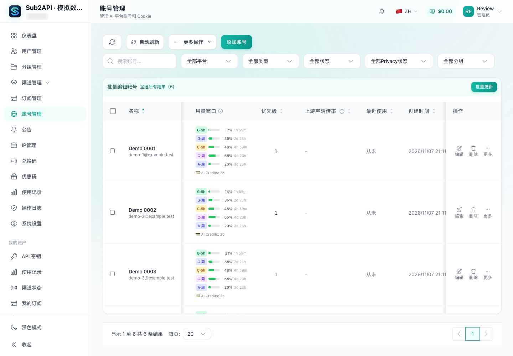
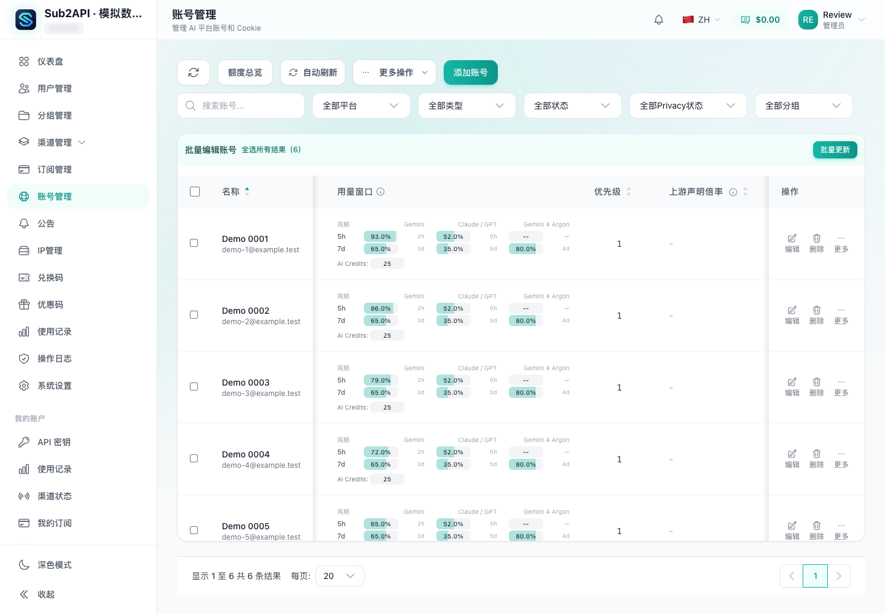
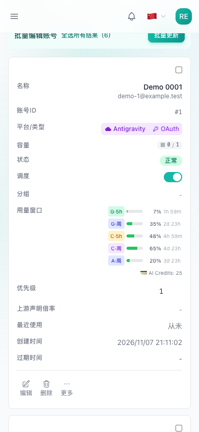
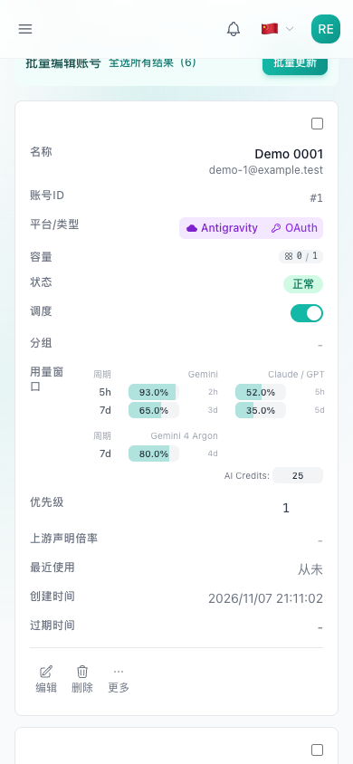
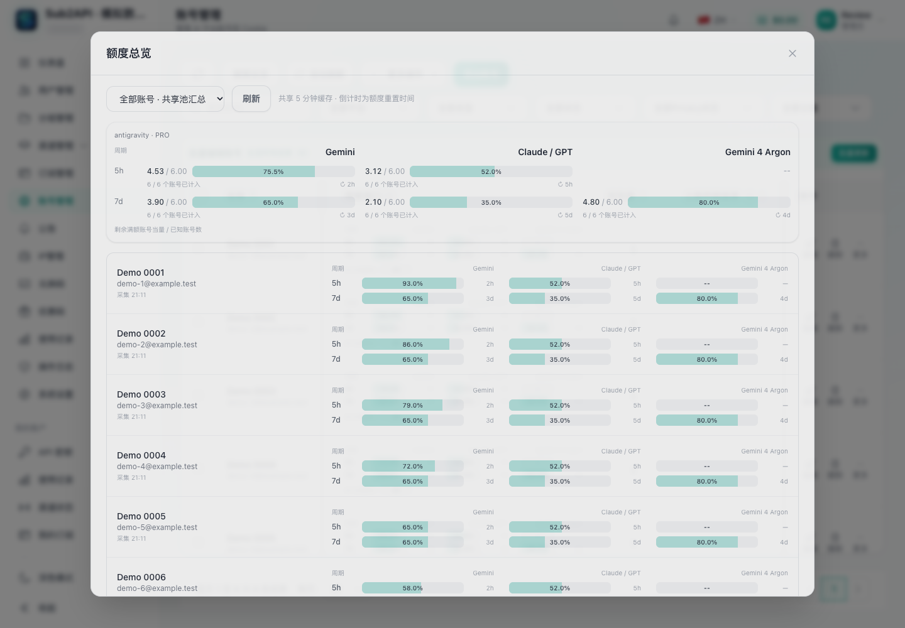
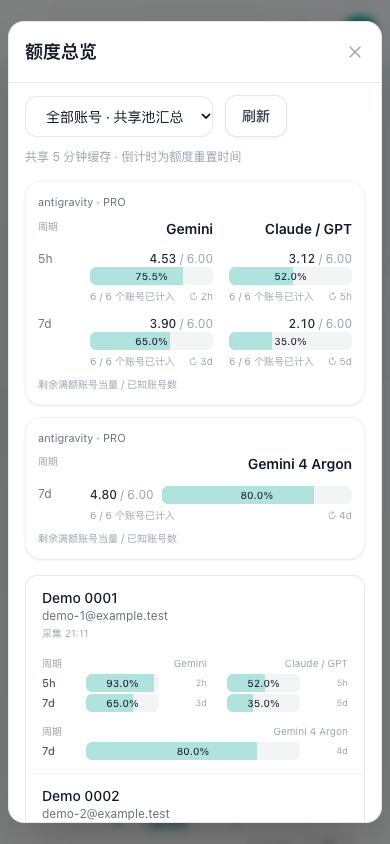
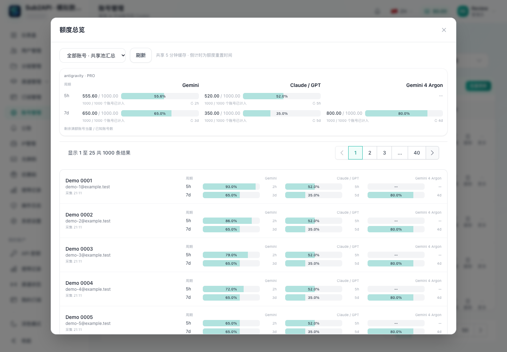

# 额度矩阵与跨账号总览：界面对比及模拟验证

2026-11-07，PR #8425。界面对照基线为 upstream/main `6b4b37db43443b5e88e424fe3c69602cc3810dfb`；性能修复前基线为本 PR 的 `5faf7ad5af76ed39fd1e7c232374c8dd194ce8ec`。

## 界面对比

以下均为生产构建的浏览器原始截图，使用相同的 6 个模拟账号。上游界面显示已用比例，矩阵显示剩余比例，因此同一额度的 7% 已用对应 93% 剩余。

| 场景 | upstream/main | 本 PR |
| --- | --- | --- |
| 桌面账号列表 |  |  |
| 手机账号列表 |  |  |

新增总览，保留 Gemini、Claude/GPT、Argon 独立周期：

| 桌面总览 | 手机总览 |
| --- | --- |
|  |  |

1000 账号时，顶部汇总全部账号，底部明细每页 25 条：



## 环境与方法

- macOS，Playwright 1.62.1，Edge 157.0.4341.42；桌面视口 1440×1000，手机视口 390×844，未开启 CPU 限速。
- 独立浏览器上下文；静态服务只绑定 `127.0.0.1`。所有 API 均由脚本模拟，所有非本地请求均被拦截并中止，包括页面自带支付 SDK 的加载请求。没有连接实际部署、账号或提供商。
- 数据集：100 / 500 / 1000 个 Antigravity PRO 账号，3 个模型组、5 个额度窗口；列表接口延迟 25 ms，额度批量接口延迟 50 ms。
- 从点击总览前计时，等待完整采集结束并额外等待 100 ms；DOM 数统计弹窗内所有元素。长任务统计浏览器报告的 ≥50 ms 主线程任务，另采样 2.2 秒空闲帧间隔。
- 以下为本机单次采样，衡量前端渲染与模拟请求调度；真实提供商响应时间取决于上游。修复后性能采样单独运行，未与完整测试套件并行。

## 发现与修复

原实现一次渲染全部明细，1000 账号产生约 4.6 万个元素，最大主线程长任务约 503 ms；列表已经获取部分账号后，总览仍可能发出包含 980 个账号的单次额度请求。

本次改为：

- 明细每页 25 条，汇总仍覆盖全部账号；按账号建立额度索引，避免为每个账号反复扫描全量额度。
- 共享缓存按最多 50 个账号串行批量查询；列表与总览继续合并重复请求，一个批次失败后继续后续批次。
- 登录用户切换时丢弃旧队列中尚未发出的请求，防止旧结果写入新用户缓存。

| 视口 / 账号数 | 完整加载：修复前 → 后 | 弹窗元素：修复前 → 后 | 最大长任务：修复前 → 后 | 明细行：修复前 → 后 |
| --- | --- | --- | --- | --- |
| 桌面 / 100 | 369 → 344 ms | 4680 → 1327 | 未观察到 → 未观察到 | 100 → 25 |
| 桌面 / 500 | 693 → 1017 ms | 23080 → 1728 | 212 ms → 未观察到 | 500 → 25 |
| 桌面 / 1000 | 1225 → 2034 ms | 46080 → 2228 | 503 ms → 未观察到 | 1000 → 25 |
| 手机 / 1000 | 1242 → 1980 ms | 47084 → 2257 | 516 ms → 未观察到 | 1000 → 25 |

串行分批增加了大账号量下的完整采集时间，同时限制单次请求规模并降低渲染开销。修复后各场景空闲最大帧间隔为 17–18 ms。

慢请求夹具额外规定：超过 100 个账号的额度请求延迟 31 秒，其余仍为 50 ms。修复前触发客户端 30 秒超时，1000 个账号中 980 个首次读取失败；修复后约 2023 ms 完成，首次读取及手动刷新均为 0 个错误。该夹具专门验证大批次超时路径。

精简原始测量见 [metrics.json](screenshots/quota-overview/metrics.json)。

## 功能与回归验证

- 100 / 500 / 1000 账号与手机视口全部通过；单次额度请求最多 50 个账号，同一轮每个账号只查询一次。
- 翻页与筛选不新增额度请求；翻页保留全量汇总；单账号筛选可定位到最后一个账号，恢复全部后回到第一页。
- 关闭重开总览、刷新浏览器均复用缓存，新增额度请求为 0；手动刷新明确携带 `force=true`，完整更新每个账号一次。
- 100 账号中模拟 10% 读取失败，错误可见；手动刷新恢复。单元测试另覆盖整批异常后继续加载、重试恢复和登录用户切换。
- 浏览器运行时错误及未模拟 API 数均为 0。
- 完整前端测试：387 个文件、3151 项通过；类型检查、ESLint、生产构建通过。

## 复现

脚本位于 [tools/quota-review.mjs](../tools/quota-review.mjs)，仅操作传入的静态构建。依赖可安装到临时目录，不修改项目依赖。

在 PR checkout 根目录构建并运行完整功能验证：

```sh
review_dir=$(mktemp -d)
pnpm --dir frontend install --frozen-lockfile
pnpm --dir frontend exec vite build --outDir "$review_dir/pr-dist"
npm install --prefix "$review_dir/browser" playwright@1.62.1
"$review_dir/browser/node_modules/.bin/playwright" install chromium
export PLAYWRIGHT_MODULE="$review_dir/browser/node_modules/playwright/index.mjs"
node tools/quota-review.mjs --after="$review_dir/pr-dist" --out="$review_dir/full" --verify=true
node tools/quota-review.mjs --after="$review_dir/pr-dist" --out="$review_dir/perf" --mode=perf --verify=true
node tools/quota-review.mjs --after="$review_dir/pr-dist" --out="$review_dir/slow" --mode=slow --verify=true
```

可设置 `BROWSER_EXECUTABLE` 使用本机已安装的 Chromium 系浏览器，本次使用 Edge。手机测试使用窄视口布局。

截图对比：在独立 checkout 构建上述 upstream/main 基线到另一绝对路径，增加 `--before=/absolute/path/to/main-dist --mode=shots`。默认完整验证还覆盖部分失败；`--mode=perf` 单独采样性能；`--mode=slow` 使用上述 31 秒夹具。

复现修复前性能或超时时，在独立 checkout 构建 `5faf7ad5`，作为 `--after` 传入同一脚本，分别使用 `--mode=perf` 或 `--mode=slow`，省略 `--verify=true`（旧版尚未实现新断言要求的分页及批量上限）。每次运行均输出 `results.json`，包含计时、请求 ID 和缓存复用记录。
