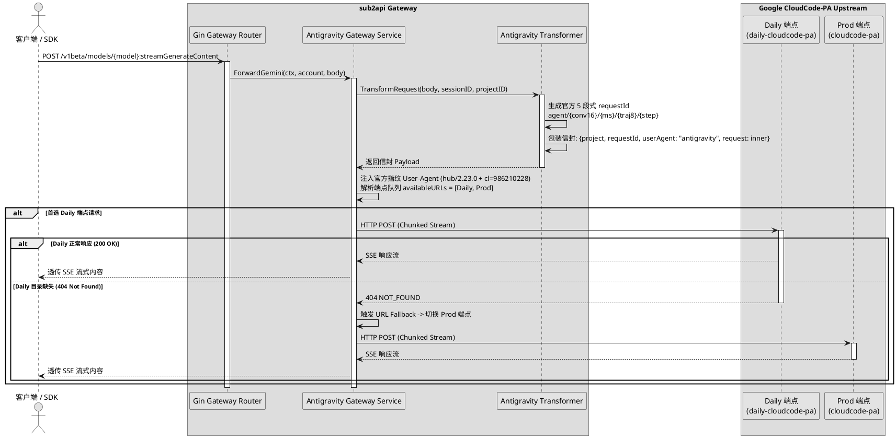

# Antigravity 反代内核韧性重构与 Google One 入口收拢设计规范

- **日期**：2026-10-16
- **目标项目**：[Wei-Shaw/sub2api](https://github.com/Wei-Shaw/sub2api)
- **参考项目**：[lbjlaq/Antigravity-Manager](https://github.com/lbjlaq/Antigravity-Manager)
- **状态**：Design Approved / Ready for Implementation Planning

---

## 1. 背景与核心痛点

### 1.1 背景
在 sub2api 中，用户尝试接入 Google One（含 AI Pro / AI Ultra）个人订阅账号时普遍遭遇调用失败。经过对 sub2api 与 Antigravity-Manager 源码的系统性比对及 upstream GitHub issues 调研，定位到以下两个维度的核心缺陷：

1. **入口配置与权限错配（必报 403）**：
   sub2api 在前端 `Gemini` 平台下提供了 `google_one` 授权选项，底层调用的是已废弃的 Gemini CLI 公共客户端 ID（`681255809395-oo8ft2oprdrnp9e3aqf6av3hmdib135j.apps.googleusercontent.com`）。
   - 若附带 `project_id`，请求发往 `cloudcode-pa.googleapis.com`，Google 限制该 Client ID 仅限企业级 Cloud AI Companion / Developer 开发者 License 使用，对消费者 Google One 账号固定拦截并报 `403 SUBSCRIPTION_REQUIRED`（#3501）；
   - 若无 `project_id`，请求降级到 AI Studio（`generativelanguage.googleapis.com`），因 OAuth token 缺少 `generative-language` scope 固定报 `403 ACCESS_TOKEN_SCOPE_INSUFFICIENT`。
2. **端点解析折叠与容灾失效（必报 429 或 404）**：
   真正的 Google One 个人订阅权益在 Google 端是挂载在官方 Antigravity IDE 客户端在 `daily-cloudcode-pa.googleapis.com`（Daily 内部端点）上的。sub2api 虽然已存在 `pkg/antigravity` 和 `platform: antigravity`，但存在以下缺陷：
   - `internal/service/antigravity_gateway_retry.go` 中解析得到的 `availableURLs` 数组被折叠为单一元素（`availableURLs := []string{baseURL}`），导致外层重试与 URL fallback 机制被完全截断；
   - 缺少官方标准 5 段式 `requestId`（`agent/{conv16}/{unixMs}/{traj8}/{step}`），仅使用了简陋的 `agent-uuid`；
   - 出站 `User-Agent` 缺少客户端家族标识（`hub/`）与 Google Piper monorepo 官方 changelist（`cl=986210228`），导致上游新模型（如 Gemini 4 Argon、Gemini 3.8 Flash）门控报 404/403。

### 1.2 目标 (Goals)
1. **收拢产品形态入口**：在前端与后端中彻底废除/屏蔽 Gemini 平台下已失效的 `google_one` 认证选项；在 Antigravity 平台中明确支持并引导 Google One 用户通过官方 Antigravity IDE OAuth 进行接入。
2. **重构端点韧性路由**：打通 `urlFallbackLoop`，引入基于账号画像的有序多端点探测队列 `[daily, prod]`。对 Google One / 付费账号优先调度 `daily`，并在遭遇 404/408/5xx 或 URL 级 429 时无缝回退到备用端点。
3. **环境指纹与信封对齐**：对齐官方 Antigravity 5 段式 `requestId`、规范化官方 User-Agent、严格净化出站 Header，消除第三方中转特征。
4. **通过自动化测试与实机验证**：补齐单元测试，并在本地使用真实 Google One Pro 账号验证流式推理；形成高质量、符合规范的 upstream Pull Request。

### 1.3 非目标 (Non-Goals)
- 不修改底层数据库原有表结构，保持 Schema 向下兼容。
- 不引入重型外部 CGo 依赖（如复杂的逆向指纹库），复用 Go 原生与 sub2api 现有网络栈保持跨平台与纯净度。

---

## 2. 总体架构与数据流图



---

## 3. 详细设计规范

### 3.1 产品形态与认证入口收拢 (Product Entry & Auth Flow)

#### 3.1.1 前端 UI 改造 (`frontend/src/components/account/CreateAccountModal.vue` & `ReAuthAccountModal.vue`)
1. **移除 Gemini 下失效的 `google_one` 选项**：
   - 从 `geminiOAuthType` 单选按钮组中移除 `google_one` 卡片，仅保留 `code_assist` (GCP Code Assist) 与 `ai_studio` (AI Studio)。
   - 默认选中值由 `'google_one'` 调整为 `'code_assist'`。
2. **增强 Antigravity 平台引导与预设**：
   - 在 Antigravity 平台选择区增加明确的提示文案与引导徽章：
     - *“支持 Google 个人账号、Google One AI Pro / Ultra 订阅及 Google Workspace 账号”*。
     - 提供标准 Google One 典型模型映射预设（包含 Gemini 4 Argon、Gemini 3.8 Flash、Claude 3.7 Sonnet 等）。
3. **多语言更新 (`frontend/src/locales/{zh-CN,en-US}.json`)**：
   - 补充 Antigravity 平台的 Google One 支持说明，移除原 Gemini 下无用的 google_one 说明词条。

#### 3.1.2 后端入口拦截与存量兼容 (`backend/internal/service/gemini_oauth_service.go` & `backend/internal/handler/account.go`)
1. **拦截失效的 OAuth 请求**：
   - 在生成 Gemini OAuth URL 时，若检测到 `oauth_type == "google_one"`，直接返回业务错误提示：
     `"Google One 认证已收拢至 Antigravity 平台。请在添加账号时选择【Antigravity】平台并完成 Google 授权。"`
2. **存量账号管理**：
   - 在账号列表读取时，若账号为 `platform == "gemini"` 且 `credentials.oauth_type == "google_one"`，在列表返回的标签中标记 `deprecated: true`，前端展示禁用与重新添加引导。
   - 在网关转发层拦截旧账号调用，返回 400 状态码及明确的迁移指引，避免向上游发出无效请求。

---

### 3.2 后端端点韧性路由设计 (Resilient Upstream Routing)

#### 3.2.1 有序端点解析器 (`backend/internal/service/antigravity_gateway_retry.go`)
重构原有的 `resolveAntigravityForwardBaseURL`，替换为支持返回候选队列的 `resolveAntigravityForwardBaseURLs(account *Account) []string`：

```go
// resolveAntigravityForwardBaseURLs 解析 Antigravity 转发候选端点有序队列。
//
// 1. 显式环境变量 GATEWAY_ANTIGRAVITY_FORWARD_BASE_URL 优先，若显式配置则将其置于首位。
// 2. 账号为 Google One / Paid Tier 时，由于配额部署在 Daily 端点，队列固定为 [Daily, Prod]；
// 3. 普通/免费账号队列为 [Prod, Daily]；
// 4. 当首选端点遭遇 404（模型缺失）或 429（限流）或 5xx 时，依次向后 fallback。
func resolveAntigravityForwardBaseURLs(account *Account) []string {
    dailyURL := antigravity.DailyBaseURL // https://daily-cloudcode-pa.googleapis.com
    prodURL := antigravity.ProdBaseURL   // https://cloudcode-pa.googleapis.com

    mode := strings.ToLower(strings.TrimSpace(os.Getenv("GATEWAY_ANTIGRAVITY_FORWARD_BASE_URL")))
    if mode == "daily" || mode == "sandbox" {
        return []string{dailyURL, prodURL}
    } else if mode == "prod" {
        return []string{prodURL, dailyURL}
    }

    if accountHasAntigravityPaidTier(account) {
        return []string{dailyURL, prodURL}
    }
    return []string{prodURL, dailyURL}
}
```

#### 3.2.2 恢复 `urlFallbackLoop` 容灾通道
在 `antigravityRetryLoop` 中：
```go
availableURLs := resolveAntigravityForwardBaseURLs(p.account)
```
扩充 `handleSmartRetry` 的判据：
- **429 限流**：若当前端点返回 429 且后续有候选端点，记录日志并 `return &smartRetryResult{action: smartRetryActionContinueURL}`；
- **404 模型缺失**：若 `resp.StatusCode == http.StatusNotFound`（如某模型在 daily 尚未注册但 prod 已上线），自动切换至下一 URL 尝试；
- **401 / 400 终止重试**：遇到凭证过期（401）或参数非法（400），立即退出重试并向调用方返回，避免无效网络消耗。

---

### 3.3 请求信封与环境指纹对齐设计 (Request Envelope & Fingerprint Alignment)

#### 3.3.1 官方 5 段式 `requestId` 生成规范 (`backend/internal/pkg/antigravity/request_transformer.go`)
官方格式规范：
`agent/{conversationId16}/{unixMs}/{trajectory8}/{step}`

- `conversationId16`：基于会话 `sessionID` 进行 SHA-256 哈希取前 16 位十六进制字符。若无 sessionID 则随机生成 16 位 hex。保证同一会话的 conversationId 稳定，利于服务端关联优化。
- `unixMs`：当前 UTC 毫秒时间戳。
- `trajectory8`：每次独立调用生成 8 位随机 hex 字符串，保证单次交互的唯一隔离。
- `step`：对话轮次步数（默认 1）。

#### 3.3.2 规范化官方 User-Agent 构造 (`backend/internal/pkg/antigravity/oauth.go`)
构建与官方 Antigravity Hub 完全一致的 User-Agent 字符串：
```go
const (
    DefaultUserAgentVersion = "2.23.0"
    OfficialHubCL          = "986210228" // Google Piper monorepo official changelist
)

func BuildOfficialUserAgent(version string, osType string, arch string) string {
    if version == "" {
        version = DefaultUserAgentVersion
    }
    if osType == "" {
        osType = runtime.GOOS
    }
    if arch == "" {
        arch = runtime.GOARCH
    }
    return fmt.Sprintf("antigravity/hub/%s (aidev_client; os_type=%s; arch=%s; cl=%s)",
        version, osType, arch, OfficialHubCL)
}
```

#### 3.3.3 请求头出站净化 (`backend/internal/pkg/antigravity/client.go`)
- 严格出站白名单：仅允许出站 `Content-Type`、`Authorization`、`User-Agent`；
- 剥离中转特征头：丢弃 `x-request-id`、`x-session-id`、`x-forwarded-*`、`x-sub2api-*` 等非官方头部。

---

## 4. 测试与验证计划

### 4.1 单元测试矩阵 (`backend/internal/...`)
1. **`antigravity_rate_limit_test.go`**：
   - 测试 `resolveAntigravityForwardBaseURLs`：
     - 付费账号（`plan_type: "g1-pro-tier"`, `"g1-ultra-tier"`, `"pro"`）返回 `[daily, prod]`；
     - 免费账号返回 `[prod, daily]`；
     - 环境变量覆盖生效测试。
2. **`request_transformer_test.go`**：
   - 测试 `BuildOfficialRequestID` 输出正则匹配 `^agent/[a-f0-9]{16}/\d+/[a-f0-9]{8}/\d+$`；
   - 验证同 sessionID 下 conversationId 保持一致，不同调用下 trajectory 和时间戳独立。
3. **`oauth_test.go`**：
   - 验证 `BuildOfficialUserAgent` 包含 `hub/`、`aidev_client`、`cl=986210228` 等关键特征。
4. **`gemini_oauth_service_test.go`**：
   - 验证对 `google_one` 请求的拒绝和友好提示。

### 4.2 本地实机集成验证
1. 启动 sub2api 本地实例，使用真实 Google One Pro 账号在前端通过 Antigravity 平台授权；
2. 发起 API 调用测试（支持 `streamGenerateContent`）：
   - 模型 1：`gemini-3.8-flash-high`
   - 模型 2：`gemini-4-argon`
   - 模型 3：`claude-3-7-sonnet-20250219`
3. 验证端点回退日志：观察日志中 `URL fallback` 行为符合预期。

### 4.3 上游 PR 提交规范
- 分支命名：`feat/antigravity-google-one-resilience`
- Commit 信息遵循 Conventional Commits：
  - `feat(antigravity): add resilient multi-endpoint fallback and official request fingerprint`
  - `refactor(oauth): deprecate broken gemini google_one in favor of antigravity`
  - `test(antigravity): add tests for endpoint resolution and request id format`

---

## 5. 审查确认记录
- **方案评审结果**：已通过用户确认（Option 1 双层治理）。
- **后续阶段**：转入实施计划（Writing Implementation Plan via `writing-plans` skill）。
